# Validation and traceability

[Documentation index](../README.md#documentation)

This document traces the LSVPN-to-standard-IPsec workflow to the code that
implements it and the tests that exercise its safeguards. It is intended for
design review, change review, and operator handoff.

The workflow has two separate verification boundaries:

1. **Candidate verification** proves that the intended Panorama candidate
   objects were written, the intended spoke LSVPN references were removed, and
   protected configuration was not changed. It does **not** prove that a tunnel
   is operational.
2. **Post-commit verification** is a separate command, run after an operator
   commits, pushes, and waits for routing convergence. It compares each
   firewall's RIB and routing configuration with its pre-migration baseline.

The tool never commits Panorama, pushes a template stack, or commits a managed
firewall.

## End-to-end flow

```mermaid
flowchart TD
    A[Operator runs build] --> A0[For candidate loading: fingerprint Panorama before discovery]
    A0 --> B[Resolve spoke, hub, vsys, stacks, and templates<br/>Fingerprint endpoints before reading their plan inputs]
    B --> C{LSVPN satellite found?}
    C -- No --> C1[Report successful no-op<br/>No Panorama changes]
    C -- Yes --> D[Find the candidate template that owns the satellite]
    D --> E[Expand scope to every spoke inheriting that shared template]
    E --> F[Discover effective interface, zone, routing, portal, gateway,<br/>BGP, OSPF, static routes, and current tunnel addressing]
    F --> G{All spokes structurally compatible<br/>and all required inputs resolved?}
    G -- No --> X[Stop with discovery error]
    G -- Yes --> H[Allocate non-overlapping link addresses and unused tunnel.N interfaces]
    H --> I[Build standard IPsec plan, descriptive variables,<br/>per-device overrides, and random paired PSKs]
    I --> J[Display proposed configuration]
    J --> K{--load-candidate?}
    K -- No --> K1[End after local preview]
    K -- Yes --> L[Capture pre-change RIB and routing config<br/>for every spoke and the hub]
    L --> M[Discover exact source-owning template placement]
    M --> M1[Prepare and serialize validation manifest]
    M1 --> N[Acquire configuration and commit locks<br/>Check unfinished jobs]
    N --> O[Recheck source fingerprints<br/>Run all candidate preflight checks]
    O -- Fail --> O1[Release acquired locks<br/>Delete local route artifacts from failed attempt]
    O -- Pass --> P[Save PRE snapshot<br/>or CHK snapshot when dirty candidate is explicitly allowed]
    P --> Q[Write variables, replacement objects, routing,<br/>zone/import bindings, and remove spoke LSVPN bindings]
    Q --> R[Reread Panorama candidate configuration]
    R --> S{Post-write invariants pass?}
    S -- No --> T[Issue Panorama candidate rollback to running config]
    T --> T1[Attempt both lock releases and report failure<br/>Retain snapshot and route baselines for recovery]
    S -- Yes --> U[Attempt both lock releases and report verified candidate<br/>Publish validation manifest atomically]
    U --> U1{Lock cleanup and manifest publication succeeded?}
    U1 -- No --> U2[Exit nonzero with candidate still verified<br/>Report cleanup/artifact errors and retain recovery files]
    U1 -- Yes --> V[Candidate verified<br/>No commit or push issued]
    V --> W[Operator reviews, commits, pushes,<br/>and waits for routing convergence]
    W --> Y[Run routes verify-migration MANIFEST]
    Y --> Z[Capture new RIB and routing config on every endpoint]
    Z --> AA{Expected tunnel mappings only<br/>and equivalent routing state?}
    AA -- No --> AB[Exit nonzero and report missing,<br/>added, changed, or config-drift details]
    AA -- Yes --> AC[Report migration route verification passed]
```

Primary orchestration: [`build()`](../src/panos_tunnel_builder/cli.py#L1330),
[`_build_shared_migration()`](../src/panos_tunnel_builder/cli.py#L940), and
[`routes_verify_migration()`](../src/panos_tunnel_builder/cli.py#L590).

## Candidate transaction detail

Transaction implementation:
[`load_candidate_configuration()`](../src/panos_tunnel_builder/candidate.py#L1959),
[`_load_candidate_configuration_locked()`](../src/panos_tunnel_builder/candidate.py#L1818),
and
[`verify_candidate_configuration()`](../src/panos_tunnel_builder/candidate.py#L1700).

## Accuracy and safety checks

| Stage | Check | Failure behavior | Code | Representative regression tests |
|---|---|---|---|---|
| Identity | Resolves a managed firewall by hostname, FQDN, short hostname, or serial and rejects ambiguous identity. | Stops discovery. | [`discover_firewall_templates()`](../src/panos_tunnel_builder/inventory.py#L161) | [`test_short_hostname_resolves_fqdn`](../tests/test_inventory.py#L93) |
| Endpoint selection | Requires different hub and spoke serials and the requested vsys on each endpoint. | Stops discovery. | [`build()`](../src/panos_tunnel_builder/cli.py#L1330) | CLI selection tests in [`test_cli.py`](../tests/test_cli.py) |
| Template ownership | Finds the one candidate template that actually owns every selected satellite; the initially selected interface template does not define migration scope. | Stops on missing, ambiguous, or multiple owners. | [`discover_lsvpn_satellite_template_owner()`](../src/panos_tunnel_builder/candidate.py#L496) | [`test_discovers_satellite_owner_independently_of_interface_template`](../tests/test_candidate.py#L190) |
| Shared scope | Includes every managed firewall inheriting the owner template. Partial shared-template migration is refused. | Stops discovery. | [`discover_shared_template_scope()`](../src/panos_tunnel_builder/inventory.py#L213) | [`test_discovers_every_firewall_inheriting_shared_template`](../tests/test_inventory.py#L139) |
| Shared structure | Requires the same satellite set and equivalent spoke object/routing shape across the group. Device-specific values must be representable as variables. | Requires splitting incompatible firewalls into another migration group. | [`_build_shared_migration()`](../src/panos_tunnel_builder/cli.py#L940), [`prepare_shared_template_variables()`](../src/panos_tunnel_builder/shared_migration.py#L104) | [`test_shared_spoke_uses_one_structure_with_per_device_values`](../tests/test_shared_migration.py#L97) |
| Addressing | Requires a tunnel address pool, allocates one `/30` or `/127` per tunnel, and excludes networks already configured on any affected endpoint. | Stops planning when the pool is invalid, overlaps, or is too small. | [`allocate_tunnel_address_pairs()`](../src/panos_tunnel_builder/lsvpn.py#L1090) | Address-allocation tests in [`test_lsvpn.py`](../tests/test_lsvpn.py) |
| Tunnel interfaces | Allocates unused `tunnel.N` values; a shared spoke interface number must be free on every affected spoke. | Stops if no common/free interface can be allocated. | [`allocate_tunnel_interface_names()`](../src/panos_tunnel_builder/lsvpn.py#L1067), [`_common_tunnel_interface_names()`](../src/panos_tunnel_builder/cli.py#L919) | [`test_allocates_lowest_unused_tunnel_interface_names`](../tests/test_lsvpn.py#L200) |
| IKE local address | Resolves the effective IKE address to exactly one owning interface, then maps it back to its raw template value, including an existing Panorama variable. | Stops on missing or ambiguous ownership. | [`resolve_ike_local_endpoint()`](../src/panos_tunnel_builder/lsvpn.py#L1473), [`resolve_template_interface_address_reference()`](../src/panos_tunnel_builder/candidate.py#L414) | [`test_resolves_ike_address_to_exact_owning_interface_reference`](../tests/test_lsvpn.py#L1065), [`test_rejects_ike_address_missing_from_all_interfaces`](../tests/test_lsvpn.py#L1096) |
| Portal/gateway match | Prefers the active gateway, then an exact serial assignment, while allowing username/group-selected satellite configurations. IP and public FQDN endpoints are normalized/resolved. Multiple applicable gateways remain an explicit ambiguity. | Stops or asks the operator when no unique safe selection exists. | [`_portal_candidates()`](../src/panos_tunnel_builder/cli.py#L1109), [`_resolve_portal_gateway()`](../src/panos_tunnel_builder/cli.py#L1155), [`endpoints_match()`](../src/panos_tunnel_builder/lsvpn.py#L432) | [`test_portal_candidates_allow_username_selected_configuration`](../tests/test_cli.py#L842), [`test_endpoint_matching_resolves_fqdn_to_configured_ip`](../tests/test_lsvpn.py#L1284), [`test_rejects_more_than_one_gateway_for_a_portal`](../tests/test_lsvpn.py#L1414) |
| Routing topology | Detects virtual routers and logical-router VRFs, direct tunnel BGP, OSPF, loopback BGP over OSPF, and loopback BGP with static host-route reachability. | Leaves an unresolved requirement in the plan; candidate loading is blocked. | [`discover_dynamic_routing()`](../src/panos_tunnel_builder/lsvpn.py#L1137), [`match_loopback_bgp_transit()`](../src/panos_tunnel_builder/lsvpn.py#L1527), [`build_standard_clone_plan()`](../src/panos_tunnel_builder/lsvpn.py#L1868) | [`test_preserves_loopback_bgp_session_transiting_replacement_ospf`](../tests/test_lsvpn.py#L409), [`test_detects_loopback_bgp_transit_without_ospf`](../tests/test_lsvpn.py#L526), [`test_preserves_logical_router_route_map_advertising_link_local_loopback`](../tests/test_lsvpn.py#L648) |
| Required inputs | Refuses to write any plan still missing peer address, tunnel addressing, matching routing, route review, or loopback reachability. | Stops before the Panorama snapshot or mutation. | [`_load_candidate_configuration_locked()`](../src/panos_tunnel_builder/candidate.py#L1818) | Candidate failure-path tests in [`test_candidate.py`](../tests/test_candidate.py) |
| Dirty candidate | Canonically compares candidate with running configuration. Dirty candidate loading is blocked unless explicitly overridden. | Stops before writes. The override warns that rollback affects the entire candidate. | [`assert_clean_candidate_configuration()`](../src/panos_tunnel_builder/candidate.py#L994) | [`test_clean_candidate_guard_rejects_pending_changes`](../tests/test_candidate.py#L318) |
| Variable ownership | Checks duplicate definitions/overrides, type consistency, matching definitions, and deterministic ownership markers before adopting existing generated names. | Stops before writes rather than overwriting unrelated variables. | [`_preflight_variables()`](../src/panos_tunnel_builder/candidate.py#L198) | [`test_existing_variable_without_tool_ownership_marker_is_rejected`](../tests/test_candidate.py#L862) |
| PSK pairing | Generates a random PSK per spoke, writes both endpoints in one candidate transaction, records non-secret fingerprints, and rotates both endpoints together on rerun. | Any write/verification failure rolls back the whole candidate transaction. | [`generate_pre_shared_key()`](../src/panos_tunnel_builder/lsvpn.py#L443), [`prepare_shared_template_variables()`](../src/panos_tunnel_builder/shared_migration.py#L104) | [`test_generates_unique_high_entropy_pre_shared_keys`](../tests/test_lsvpn.py#L99), variable transaction tests in [`test_candidate.py`](../tests/test_candidate.py) |
| Object collisions | Existing tunnel interfaces must carry the exact tool/source marker. Existing IKE/IPsec names cannot be adopted without that ownership. Shared crypto profiles must be byte-equivalent after normalization. | Stops before snapshot/write on unrelated or incompatible objects. | [`_preflight_endpoint()`](../src/panos_tunnel_builder/candidate.py#L1162) | [`test_candidate_collision_fails_before_snapshot_or_write`](../tests/test_candidate.py#L516) |
| Old-interface references | Audits every candidate reference to the old spoke tunnel. Only explicitly supported zone, import, routing, BGP, OSPF, static route, and satellite bindings may be changed. | Stops and reports the exact unsupported XPath. | [`audit_spoke_interface_dependencies()`](../src/panos_tunnel_builder/candidate.py#L765) | [`test_dependency_audit_blocks_unknown_old_interface_reference`](../tests/test_candidate.py#L1068) |
| Snapshot | Saves a PAN-OS-length-safe `LSVPN_PRE_*` snapshot. An explicitly dirty run uses `LSVPN_CHK_*` so it is not mistaken for a clean baseline. | Stops if Panorama cannot save it; no candidate mutation has occurred. | [`save_pre_migration_snapshot()`](../src/panos_tunnel_builder/candidate.py#L820) | [`test_saves_named_panorama_pre_migration_snapshot`](../tests/test_candidate.py#L259), [`test_dirty_candidate_snapshot_is_labeled_as_checkpoint`](../tests/test_candidate.py#L276) |
| Candidate reread | Rereads variables and every generated candidate subtree, verifies routing membership and vsys import, and confirms every planned spoke cleanup path is absent. | Raises an error and triggers candidate rollback. | [`verify_candidate_configuration()`](../src/panos_tunnel_builder/candidate.py#L1700) | [`test_post_write_verification_accepts_complete_candidate`](../tests/test_candidate.py#L1102) |
| Protected hub LSVPN | Fingerprints the hub portal, gateway, and site-to-site LSVPN configuration before and after the write. | Any difference triggers rollback. | [`_hub_lsvpn_fingerprint()`](../src/panos_tunnel_builder/candidate.py#L1615) | Candidate post-write verification tests in [`test_candidate.py`](../tests/test_candidate.py) |
| Protected routing scope | Normalizes candidate routing XML while excluding only the exact old/new interfaces and replaced static-route names. Everything else must remain identical. | Any unrelated VR/LR/VRF protocol change triggers rollback. | [`_routing_scope_fingerprint()`](../src/panos_tunnel_builder/candidate.py#L1098) | [`test_routing_scope_normalization_allows_only_tunnel_related_changes`](../tests/test_candidate.py#L1190), [`test_routing_scope_normalization_detects_global_protocol_change`](../tests/test_candidate.py#L1233) |
| Automatic backout | Any exception after the saved snapshot invokes PAN-OS candidate rollback to running configuration. The saved snapshot is retained but is not automatically loaded. | Reports both the original and rollback errors if rollback itself fails. | [`rollback_candidate_configuration()`](../src/panos_tunnel_builder/candidate.py#L860), [`_load_candidate_configuration_locked()`](../src/panos_tunnel_builder/candidate.py#L1818) | [`test_candidate_write_failure_automatically_rolls_back_candidate`](../tests/test_candidate.py#L633), [`test_candidate_write_reports_automatic_rollback_failure`](../tests/test_candidate.py#L673) |
| Post-commit RIB | Compares firewall serial/vsys, routing instance/VRF, normalized prefix, protocol, distance, metric, selected/installed state, and every ECMP path. Expected old-to-new tunnel path mappings and new connected/local link routes are narrowly recorded in the manifest. | Returns nonzero for missing routes, unrelated additions, or changed expected candidates. | [`compare_route_snapshots()`](../src/panos_tunnel_builder/route_validation.py#L832), [`_migration_endpoint_rules()`](../src/panos_tunnel_builder/cli.py#L326) | [`test_migration_compare_allows_new_link_routes_and_extra_candidates`](../tests/test_route_validation.py#L440), [`test_migration_compare_still_rejects_unrelated_added_route`](../tests/test_route_validation.py#L475) |
| Route capture completeness | Requires recognized successful responses and valid observed records for every discovered router; records the instance coverage in version 2 snapshots. | Rejects unrecognized, incomplete, or malformed responses and comparisons with older snapshots or mismatched coverage. Version 1 baselines require independent manual verification after migration. | [`capture_route_snapshot()`](../src/panos_tunnel_builder/route_validation.py), [`compare_route_snapshots()`](../src/panos_tunnel_builder/route_validation.py) | [`test_route_completeness.py`](../tests/test_route_completeness.py) |
| Post-commit config | Compares effective virtual-router and logical-router/VRF configuration after removing only manifest-approved interface, peer, OSPF, and exact static-route changes. | Returns nonzero for any other routing-configuration drift. | [`compare_routing_configurations()`](../src/panos_tunnel_builder/route_validation.py#L769) | [`test_routing_configuration_ignores_interface_member_order`](../tests/test_route_validation.py#L345), CLI verifier tests in [`test_route_validation.py`](../tests/test_route_validation.py) |

## Artifacts and audit trail

| Artifact | Created when | Contains secrets? | Purpose |
|---|---|---:|---|
| Terminal preview | Every plan | PSK only with explicit `--show-secrets` | Human review of scope, endpoints, naming, addressing, routing, and crypto. |
| `LSVPN_PRE_*.xml` Panorama saved config | Clean candidate load | Yes, as protected Panorama configuration | Manual recovery point representing a clean pre-migration candidate. |
| `LSVPN_CHK_*.xml` Panorama saved config | Dirty migration explicitly allowed, or before snapshot restore | Yes, as protected Panorama configuration | Checkpoint containing the current candidate, including pending changes; not asserted to be a clean baseline. |
| `LSVPN_PRE_MIGRATION_*_routes.json` | Before candidate load | May include routing authentication material | Sensitive per-firewall RIB plus raw effective routing configuration baseline. |
| `LSVPN_MIGRATION_*_validation.json` | Successful candidate verification | Sensitive identities/topology; no generated PSKs | Binds endpoints and baseline files to the exact expected interface, next-hop, prefix, and routing-config exceptions. |
| `LSVPN_POST_MIGRATION_*_routes.json` | `routes verify-migration` | May include routing authentication material | Sensitive evidence captured after commit/push/convergence for comparison and troubleshooting. |

All local snapshot and manifest writes use private staging files and atomic
publication. On POSIX, file modes are `0600`; newly created artifact directories
request `0700`. Existing directories and old captures are not modified. Retained
manifest staging files use the same private file mode. Raw routing configuration
is preserved for verification, not automatically redacted. See
[artifact handling and sharing](usage.md#protecting-and-sharing-artifacts).

Snapshot restore has a separate checkpoint recovery policy: both lock acquisitions, job check,
checkpoint save, requested load, optional reload of the checkpoint on failure,
then independent lock releases. Tests in `test_candidate.py` cover that API order, contention,
checkpoint failure, pending-work preservation on load failure/interruption,
failed recovery, and independent lock-cleanup reporting. CLI tests cover
confirmation wording, checkpoint reporting, and nonzero/130 exit statuses. These
checks use simulated API responses; live restore/recovery validation remains
outstanding.

Lock acquisition failures, unfinished or malformed job listings, interrupted
acquisition, and independent cleanup failures are covered in
[`test_candidate_locks.py`](../tests/test_candidate_locks.py). Only confirmed
acquisitions authorize cleanup; commit protection remains through recovery.
Live competing-administrator and queued-commit checks remain outstanding.

Source-drift tests in
[`test_source_configuration.py`](../tests/test_source_configuration.py) cover
Panorama, hub, selected spoke, and additional shared spokes; changes to candidate,
running, and effective-running configuration; and a committed change that leaves
candidate and running equal. They verify rejection before snapshot or mutation,
independent lock cleanup, failed/interrupted reads, and successful unchanged-source
loading. Full configuration fingerprints stay in memory and are mandatory for
the transaction entry point. CLI tests verify the pre-discovery captures are
passed to the transaction.

## What the checks do not prove

- Candidate verification does not prove IKE/IPsec establishment, BGP/OSPF
  adjacency, or dataplane forwarding. Those objects have not been committed or
  pushed yet.
- The post-check does not wait for convergence. The operator must run it only
  after IKE/IPsec and routing have had time to settle.
- Route capture checks known response shapes, observed records, and reported
  counts; it cannot detect routes omitted by the device without a truncation
  indicator. Verify supported response formats against each deployed release.
- Route equivalence is evidence of control-plane equivalence, not an end-to-end
  application traffic test. A separate traffic validation is still appropriate.
- Public FQDN matching depends on DNS answers available when discovery runs.
- Destination hostname plus sequence names are not globally unique. Candidate
  object ownership and collision preflight prevent unrelated existing objects
  from being overwritten.
- The Panorama configuration lock serializes configuration changes made through
  cooperating lock-aware clients. It does not freeze managed-firewall operational
  state while pre-change route snapshots are being captured.
- With `--allow-pending-candidate-changes`, PAN-OS candidate rollback returns the entire
  candidate to running configuration and therefore discards other pending
  changes. The command warns about this before loading.
- Automated tests are primarily mocked unit/regression tests. They validate
  parsing, decisions, generated structure, API sequencing, error handling, and
  comparisons; they are not a substitute for testing against each deployed
  PAN-OS/Panorama release and topology.

## Verification records

### Local review: September 30, 2026

After removing router renaming, 159 tests passed. Ruff, mypy (9 source files),
Pyright (0 errors and warnings), and the wheel build passed. Coverage was not
remeasured. Regression checks include invalid connection settings, empty
migration manifests, and rejection of the removed router-renaming option.
See [contributing](../CONTRIBUTING.md#checks) for reproducible check commands.

### Input-usability follow-up: September 30, 2026

After clarifying input names and adding template-name selection, 184 tests
passed, along with Ruff, mypy, and Pyright. Regression coverage includes
selection by exact name after stack reordering, selector conflicts, CLI overrides
of TOML defaults, and the renamed confirmation, overwrite, artifact-directory,
and manifest-file settings. These checks use mocks and did not modify Panorama.

### Historical lab validation

The following results were recorded in the earlier implementation notes. They
are historical observations, not evidence that every later change was tested
live:

- Read-only live route snapshots and independent-capture comparisons have been
  validated against both an advanced-routing logical-router firewall and
  `labPAN4` using the legacy virtual-router engine. The legacy validation also
  covers compact PAN-OS route flags such as `A?B`.
- The full candidate-only LSVPN replacement workflow has been validated live
  from `labPAN1` to `labPAN3` with `10.251.50.0/30`. Panorama reread verification
  passed, the old spoke satellite and `tunnel.20` were absent, both replacement
  endpoint object sets were present, and the hub LSVPN gateway remained intact.
  No commit or push was issued.
- Shared-template batching was validated live with `labPAN1` and `labPAN2`
  sharing `labBasicNetworkConfig` and `labPAN3` as the hub. A `10.251.50.0/29`
  pool supplied two `/30` links. Panorama accepted the shared spoke objects,
  per-device address/PSK overrides, and both serial-scoped hub endpoints;
  post-write verification passed with no commit or push.
- The same live candidate migration was run a second time. It updated the same
  objects, removed zero additional legacy bindings, preserved the complete PSK
  variable set, and passed post-write verification, confirming candidate-level
  idempotency. That historical validation predates the current safer rerun
  behavior, which rotates both ends of every PSK pair because encrypted Panorama
  values cannot prove that the stored plaintext still matches.

### Remaining live validation

Latest destination-based tunnel naming has local fixture coverage but was not
exercised against live Panorama during the September 30 review. A lab
candidate-load check and operator-controlled post-commit route verification
remain appropriate before production use. Candidate verification alone does not
establish forwarding or application connectivity.

### Optional spoke virtual-router rename

`--spoke-virtual-router-name` validates names, router ownership, stack assignments,
target-name collisions, local candidate/running router definitions and references
that would retain the old name, and every consumer of a changed template before candidate loading. It refuses to merge
routers or rename logical-router VRFs. The migration's shared spoke group must
include all consumers; a hub or unrelated firewall consumer blocks the rename.

After the normal tunnel-migration checks, the loader uses the native rename API
for every source router fragment, updates cross-template imports and `next-vr`
references, and rereads the full candidate. Only the planned router names and
references may differ, ignoring Panorama metadata and unordered router/import
lists. Verification failure or interruption invokes the existing rollback.
Spoke manifest entries map router identities and next-router references during
post-push checks; hub entries have no rename mapping. Stateful XML tests cover
native reference updates, inherited references, stack overrides, preserved hub
configuration, outside consumers, collisions, drift, and rollback. No live
firewall validation of this optional feature has been performed.
